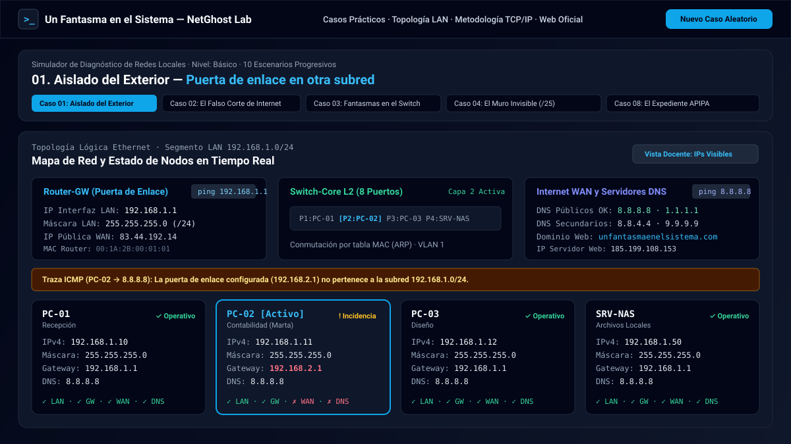
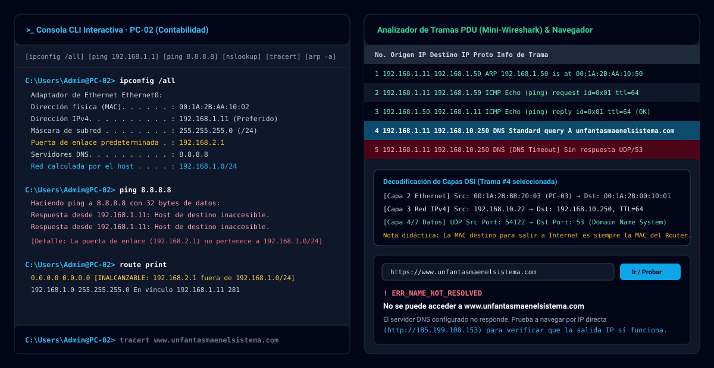
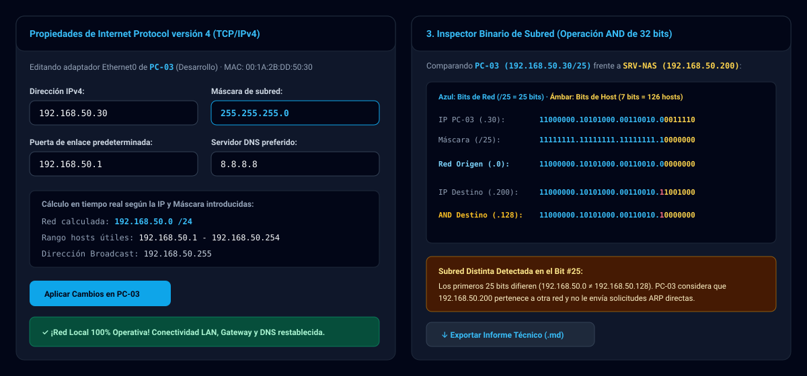

<div align="center">
  <a href="https://www.unfantasmaenelsistema.com/" target="_blank" rel="noopener noreferrer">
    
  </a>

  # NetGhost Lab — Troubleshooter de Configuración de Red Local

  **Simulador interactivo de diagnóstico, análisis de tramas PDU y resolución de averías silenciosas en redes TCP/IPv4**

  [](https://www.unfantasmaenelsistema.com/)
  [](https://react.dev/)
  [](https://www.typescriptlang.org/)
  [](https://tailwindcss.com/)
  [](https://pages.github.com/)
</div>

---

## Descripción del Proyecto

**NetGhost Lab** es un laboratorio virtual interactivo diseñado para estudiantes y docentes de **Redes Locales, Sistemas Microinformáticos y Redes (SMR), Administración de Sistemas Informáticos en Red (ASIR), Desarrollo de Aplicaciones (DAM/DAW) y certificaciones de redes (CCNA / CompTIA Network+)**.

La aplicación presenta una topología realista con **4 equipos en red local (LAN)** conectados a un **Switch L2 Ethernet**, un **Router / Puerta de Enlace (Default Gateway)** y salida hacia **Internet WAN y servidores DNS públicos** (`8.8.8.8`, `1.1.1.1`, `www.unfantasmaenelsistema.com`).

En cada escenario se introducen **fallos silenciosos de configuración TCP/IPv4** (puerta de enlace en otra subred, servidor DNS inexistente, conflicto ARP de IP duplicada, máscara de subred CIDR asimétrica `/25`, `/26`, `/28` o direcciones APIPA `169.254.x.x`). El alumno debe investigar el problema utilizando comandos reales en la consola virtual (`ipconfig`, `ping`, `tracert`, `nslookup`, `curl`, `arp -a`, `route print`), inspeccionar las tramas generadas en el **Analizador PDU (Mini-Wireshark)**, emitir su dictamen técnico y reparar la configuración TCP/IPv4.

---

## Capturas de Pantalla

### 1. Mapa de Topología Interactiva LAN/WAN y Estado por Capas


### 2. Consola CLI Virtual, Analizador de Tramas PDU (Mini-Wireshark) y Navegador Web de Prueba


### 3. Editor de Propiedades TCP/IPv4 en Vivo e Inspector Binario de Subred (32 bits)


---

## Características Didácticas Principales

1. **Motor Matemático IPv4 Real (32 bits)**:
   - Cálculo bit a bit de dirección de red (`IP AND Máscara`), dirección de difusión (*Broadcast*), prefijo CIDR y rango de hosts útiles.
   - Simulación auténtica de enrutamiento de ida y vuelta: comprueba si el origen ve al destino en su subred según su propia máscara y si el destino o el router pueden devolver los paquetes ICMP Echo Reply.
2. **Consola de Comandos Interactiva (`NetGhost CLI`)**:
   - Soporta `ipconfig`, `ipconfig /all`, `ipconfig /flushdns`, `ping <IP | dominio | host>`, `tracert <IP | dominio>`, `nslookup <dominio> [servidor_dns]`, `curl <url>`, `arp -a`, `arp -d *`, `route print`, `hostname`, `whoami`, `help` y `cls`.
   - Incluye barra de comandos rápidos para agilizar las sesiones prácticas en aula o desde tablets.
3. **Analizador de Tramas PDU (Mini-Wireshark)**:
   - Captura en tiempo real las tramas `ARP`, `ICMP`, `DNS` y `HTTP` generadas al ejecutar comandos.
   - Decodifica las **Capas OSI 2 (Ethernet II MAC Origen → MAC Destino)**, **Capa 3 (IPv4 Origen, Destino, TTL)** y **Capa 4/7 (ICMP / UDP Puerto 53 / HTTP)**, demostrando por qué la MAC de destino hacia Internet es siempre la MAC de la interfaz LAN del Router.
4. **Navegador Web Integrado (Contraste DNS vs. IP Directa)**:
   - Permite probar el acceso a `https://www.unfantasmaenelsistema.com` frente a la IP directa `http://185.199.108.153` o el panel del router (`http://192.168.1.1`), visualizando errores reales como `ERR_NAME_NOT_RESOLVED`, `ERR_ADDRESS_UNREACHABLE` o `ERR_CONNECTION_TIMED_OUT`.
5. **Inspector Binario de Subredes (Operación Lógica `AND`)**:
   - Muestra los 32 bits coloreados en **Porción de Red** y **Porción de Host**, comparando el equipo activo frente a cualquier IP de la topología para localizar exactamente qué bit separa dos subredes en máscaras `/24`, `/25`, `/26` o `/28`.
6. **Modo Examen (IPs Ocultas) y Exportación de Informe (`.md`)**:
   - El **Modo Examen** oculta los parámetros de las tarjetas de la topología obligando al estudiante a descubrir la configuración ejecutando `ipconfig` puesto por puesto.
   - El botón **Exportar Informe (`.md`)** descarga un documento Markdown completo con la tabla TCP/IPv4, los casos superados y el historial de comandos ejecutados para entregar al profesor.

---

## Catálogo de los 10 Escenarios Guiados + Generador Aleatorio

| # | Escenario | Nivel | Fallo Silencioso Introducido | Objetivo de Aprendizaje |
| :-: | :--- | :---: | :--- | :--- |
| **01** | **Aislado del Exterior** | Básico | Puerta de enlace en otra subred (`192.168.2.1`) | Verificar que el *Default Gateway* pertenece a la subred local y coincide con la IP LAN del router. |
| **02** | **El Falso Corte de Internet** | Básico | Servidor DNS inexistente (`192.168.10.250`) | Distinguir entre conectividad IP (`ping 8.8.8.8` OK) y resolución de nombres (`nslookup` / `ERR_NAME_NOT_RESOLVED`). |
| **03** | **Fantasmas en el Switch** | Intermedio | Dirección IP duplicada (`10.0.0.15` en dos nodos) | Detectar colisiones ARP mediante `arp -a`, `ipconfig /all` y tramas *Gratuitous ARP*. |
| **04** | **El Muro Invisible de la Máscara** | Intermedio | Máscara de subred `/25` (`255.255.255.128`) | Comprender cómo una máscara `/25` divide la red en dos bloques (`.1-.126` y `.129-.254`), aislando al servidor `.200`. |
| **05** | **Baile de Octetos** | Básico | IP del host en otra subred (`172.16.100.11/24`) | Identificar errores tipográficos en los octetos de red mediante `ipconfig` y `route print`. |
| **06** | **Subredes Corporativas /28** | Avanzado | Host fuera del rango CIDR `/28` (`255.255.255.240`) | Calcular bloques de 16 direcciones en subredes `/28` (rango útil `.1` a `.14`, broadcast `.15`). |
| **07** | **Guardia de Viernes Tarde** | Avanzado | Doble fallo simultáneo (DNS + Gateway erróneo) | Diagnosticar incidencias independientes en múltiples equipos aplicando la metodología de 5 pasos. |
| **08** | **El Expediente APIPA 169.254** | Intermedio | Autoconfiguración APIPA (`169.254.84.19/16`) | Reconocer el direccionamiento RFC 3927 asignado automáticamente cuando falla el servidor DHCP. |
| **09** | **El Gateway Impostor** | Intermedio | Gateway apuntando a un servidor NAS (`.50`) | Comprobar que la puerta de enlace debe ser el router con salida WAN y no otro host local aunque responda al ping. |
| **10** | **Auditoría Crítica de Sistemas** | Avanzado | Triple avería combinada (IP duplicada + `/26` + DNS) | Auditar y reparar una red corporativa completa hasta alcanzar el 100% de operatividad. |
| **∞** | **Nuevo Caso Aleatorio** | Variable | Generador procedimental infinito | Practicar con nuevos direccionamientos y averías aleatorias en cada sesión. |

---

## Instalación y Uso Local

### Requisitos previos
- **Node.js** 18+ (recomendado Node.js 20 o 22) y `npm`.

### Pasos de ejecución

```bash
# 1. Clonar el repositorio
git clone https://github.com/TU_USUARIO/troubleshooter-red-local.git
cd troubleshooter-red-local

# 2. Instalar dependencias
npm install

# 3. Iniciar el servidor de desarrollo (puerto 3000)
npm run dev

# 4. Generar el paquete estático de producción para GitHub Pages
npm run build
```

---

## Despliegue en GitHub Pages

El proyecto ya está configurado con `base: './'` en `vite.config.ts` y cuenta con el flujo de trabajo oficial en `.github/workflows/deploy.yml`:

1. Sube este repositorio a tu cuenta de **GitHub** (rama `main` o `master`).
2. En tu repositorio de GitHub, entra en **Settings → Pages**.
3. En la sección **Build and deployment → Source**, selecciona **GitHub Actions**.
4. Con cada `git push`, la acción compilará automáticamente la aplicación y la publicará en `https://TU_USUARIO.github.io/NOMBRE_DEL_REPO/`.

---

## Créditos y Autoría

Desarrollado con fines educativos para [**Un Fantasma en el Sistema**](https://www.unfantasmaenelsistema.com/).
- **Sitio Web Oficial:** [https://www.unfantasmaenelsistema.com/](https://www.unfantasmaenelsistema.com/)
- **Licencia:** Apache-2.0 / Uso educativo libre citando la fuente.
