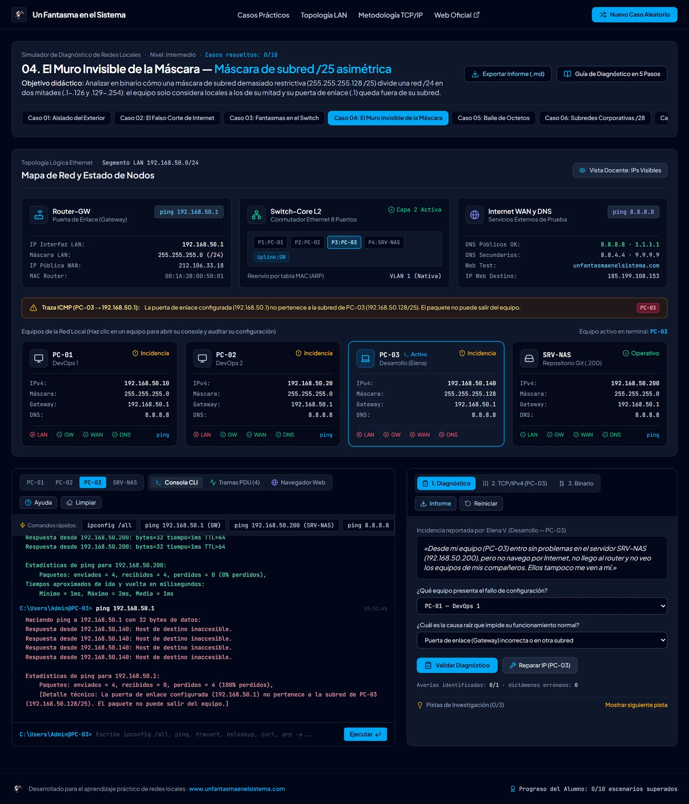
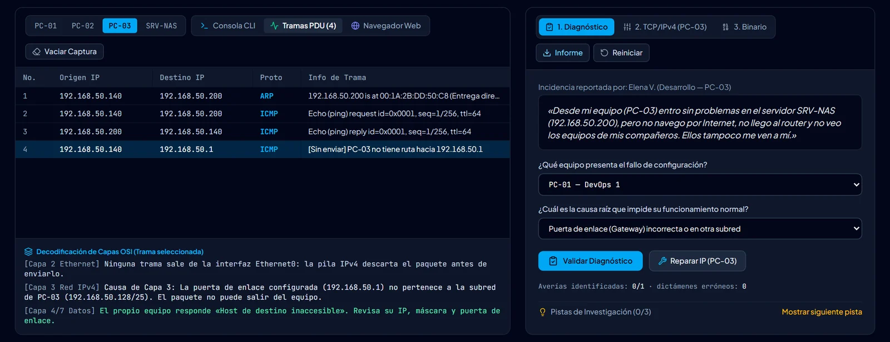
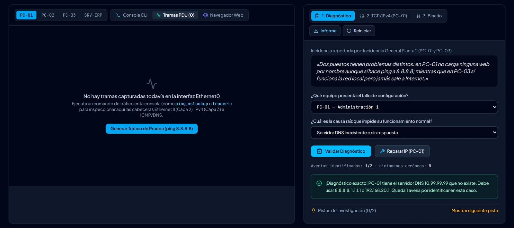
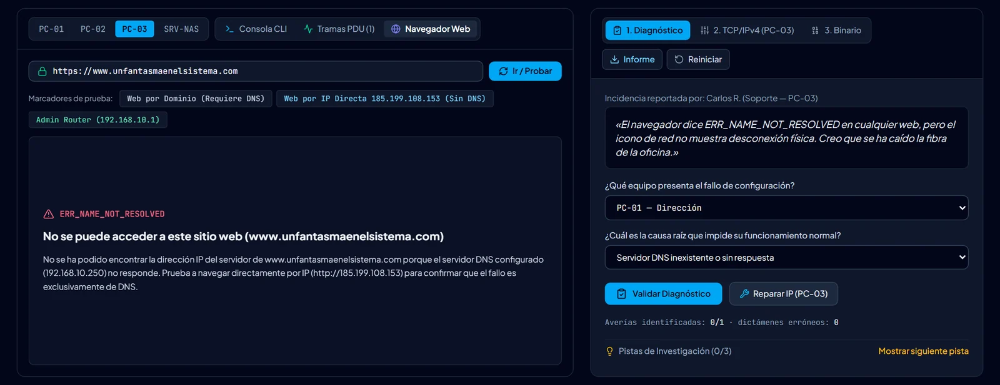

<p align="center">
  <a href="https://www.unfantasmaenelsistema.com"></a>
</p>

<h1 align="center">NetGhost Lab — Troubleshooter de Red Local</h1>

<p align="center">
  <b>Diagnostica y repara redes locales con fallos TCP/IPv4 reales, como en una oficina</b><br>
  10 casos guiados + retos aleatorios · Consola con ipconfig, ping, tracert, nslookup, arp, route y curl · Analizador de tramas · Navegador de prueba · Inspector binario
</p>

<p align="center">
  <a href="https://unfantasmaenelsistema.github.io/NetGhostLab-Troubleshooter-Red-Local/"><b>▶ Abrir NetGhost Lab</b></a> ·
  <a href="#qué-hace">Qué hace</a> ·
  <a href="#los-10-casos">Los 10 casos</a> ·
  <a href="#cómo-se-supera-un-caso">Cómo se supera un caso</a> ·
  <a href="#desarrollo">Desarrollo</a> ·
  <a href="https://www.unfantasmaenelsistema.com">unfantasmaenelsistema.com</a> ·
  <a href="LICENSE">MIT</a>
</p>

<p align="center">
  
  
  
  
</p>

<p align="center">
  
</p>

Cada caso es una pequeña oficina (router, switch, cuatro equipos e Internet) con uno o varios fallos de configuración TCP/IPv4. Llega un ticket con lo que cuenta el usuario, y hay que hacer lo mismo que en un puesto de soporte: probar desde las consolas de los equipos, leer lo que pasa en el cable, decidir qué equipo falla y por qué, y corregir su configuración hasta que toda la red funcione.

> [!NOTE]
> Todo es una simulación que funciona en el navegador, sin servidor ni peticiones reales. El progreso se guarda solo en el `localStorage` de ese navegador.

## Qué hace

- **Consola de cada equipo**: `ipconfig` (y `/all`, `/flushdns`), `ping`, `tracert`, `nslookup` (con servidor opcional), `curl`, `arp -a` y `arp -d`, `route print`, `hostname`, `whoami`, `help` y `cls`, con salidas al estilo de Windows en español.
- **Simulación realista de la ruta de ida y vuelta**: cada equipo decide con **su** máscara si el destino es local (ARP directo) o va a la puerta de enlace; se comprueba que el destino o el router puedan devolver la respuesta, se detectan conflictos de IP y, si el router tiene que reenviar tráfico entre dos equipos de su propia LAN, lo hace y avisa con un **ICMP Redirect**, como en una red real.
- **Analizador de tramas (mini-Wireshark)**: ARP, ICMP, DNS y HTTP de cada comando, con el detalle de capa 2, 3 y 4. Si el paquete no puede salir del equipo, no aparece ninguna trama en el cable.
- **DNS coherente**: el mismo nombre da la misma IP en `ping`, `tracert`, `nslookup` y el navegador; un dominio que no existe devuelve **NXDOMAIN** (distinto de un servidor DNS que no responde).
- **Navegador de prueba** para comparar el acceso por nombre y por IP (`ERR_NAME_NOT_RESOLVED`, `DNS_PROBE_FINISHED_NXDOMAIN`, `ERR_ADDRESS_UNREACHABLE`…).
- **Inspector binario** de 32 bits para ver qué bit separa dos subredes.
- **Topología con modo docente o a ciegas**: a ciegas, el estado de un equipo solo se ve después de probar desde su consola.
- **Informe en Markdown** con la configuración, el dictamen del alumno y todos los comandos ejecutados.

<p align="center">
  
</p>

## Los 10 casos

| # | Caso | Nivel | Avería | Qué se aprende |
| :-: | :-- | :-: | :-- | :-- |
| 01 | Aislado del exterior | Básico | Puerta de enlace en otra subred | La puerta de enlace tiene que estar en la subred del equipo y ser el router. |
| 02 | El falso corte de Internet | Básico | Servidor DNS inexistente | `ping 8.8.8.8` funciona y `nslookup` no: es DNS, no la conexión. |
| 03 | Fantasmas en el switch | Intermedio | IP duplicada | Conflictos ARP con `arp -a`, `ipconfig /all` y el ARP gratuito. |
| 04 | El muro invisible de la máscara | Intermedio | Máscara /25 en un equipo de la mitad alta | Con /25 el equipo solo ve su mitad de la red y su puerta de enlace queda fuera. |
| 05 | Baile de octetos | Básico | IP en otra subred | Erratas en los octetos de red. |
| 06 | Subredes corporativas /28 | Avanzado | Equipo fuera del bloque /28 | Bloques de 16 direcciones (útiles .1 a .14, broadcast .15). |
| 07 | Guardia de viernes tarde | Avanzado | DNS y puerta de enlace en dos equipos | Dos averías independientes a la vez. |
| 08 | El expediente APIPA | Intermedio | IP 169.254.x.x por fallo de DHCP | Reconocer la autoconfiguración APIPA (RFC 3927). |
| 09 | El gateway impostor | Intermedio | Puerta de enlace apuntando a un servidor | La puerta de enlace es el router, no otro equipo que responde al ping. |
| 10 | Auditoría crítica | Avanzado | IP duplicada + máscara /26 + DNS | Auditar y reparar toda la red. |
| ∞ | Reto aleatorio | Variable | Una avería al azar | Practicar con direcciones nuevas (no cuenta para el progreso de los 10 casos). |

<p align="center">
  
</p>

## Cómo se supera un caso

1. **Dictamen**: en «1. Diagnóstico» se elige el equipo y la causa raíz. Cada acierto cuenta como una avería identificada y cada fallo queda registrado como dictamen erróneo.
2. **Reparación**: en «2. TCP/IPv4» se corrige la configuración del equipo.
3. El caso queda **superado** cuando se han identificado **todas** sus averías y toda la red funciona (LAN, puerta de enlace, Internet y DNS en todos los equipos). Reparar sin diagnosticar, o diagnosticar sin reparar, no basta.

El informe exportado incluye el dictamen del alumno (averías identificadas y errores) y solo muestra la solución esperada cuando el caso está superado.

<p align="center">
  
</p>

## Desarrollo

Requisitos: Node.js 20 o superior.

```bash
git clone https://github.com/unfantasmaenelsistema/NetGhostLab-Troubleshooter-Red-Local.git
cd NetGhostLab-Troubleshooter-Red-Local
npm ci
npm run dev      # http://localhost:3000
npm test         # 31 tests del motor de red y de los escenarios
npm run lint     # comprobación de tipos
npm run build    # versión estática en dist/
```

Cada `push` a `main` pasa por el workflow [`deploy.yml`](.github/workflows/deploy.yml) (tipos, tests y build) y se publica en GitHub Pages. Los pull requests ejecutan las mismas comprobaciones sin publicar.

```text
src/
├── utils/networkEngine.ts       Motor: salud de cada equipo, alcanzabilidad, comandos, tramas, DNS y navegador
├── utils/networkEngine.test.ts  Tests (Vitest): los 10 casos, 500 retos aleatorios, DNS y tracert
├── data/scenarios.ts            Los 10 casos y el generador aleatorio
├── App.tsx                      Casos, dictamen, progreso e informe
└── components/                  Topología, consola y analizador, panel de diagnóstico y metodología
```

Para añadir un caso basta con un objeto más en `scenarios.ts`. Los tests comprueban que sus averías existen, que no hay otras sin querer y que, al repararlas, toda la red funciona.

## Novedades de la versión 2

- **Un caso se daba por superado con acertar una sola avería**, aunque tuviera dos o tres (casos 7 y 10), y bastaba con reparar sin diagnosticar. Ahora hay que identificar todas y reparar la red; los dictámenes erróneos quedan registrados en pantalla y en el informe.
- **El informe exportado mostraba la solución** aunque el caso no estuviera resuelto. Ahora solo la incluye al superarlo.
- **Los casos de máscara (4 y 10) contaban un fallo que en una red real no ocurre**: un equipo con /25 o /26 en la mitad baja sí llega al resto de la LAN, porque el router reenvía el tráfico. Ahora el equipo está en la otra mitad de la red, su puerta de enlace queda fuera de su subred y el fallo es real. El motor simula el reenvío del router (con ICMP Redirect) y el generador aleatorio sigue la misma idea.
- **DNS inventado**: cualquier dominio resolvía a la IP de la web con `ping` y el navegador, y a otra distinta con `nslookup`. Ahora todo usa el mismo resolutor y los dominios inexistentes dan NXDOMAIN.
- **`tracert` daba la ruta por completada** hacia destinos que no respondían; ahora coincide con `ping`. El analizador ya no muestra tramas que nunca salen del equipo.
- Los retos aleatorios no inflan el progreso de los 10 casos; las pistas citan los nombres reales de las pestañas.
- Fuera dependencias sin uso (Gemini, Express) y las capturas dibujadas en SVG; se arregla la instalación con npm, el diseño ya no se desborda en móvil ni a 800 px, CSP en la build y licencia MIT.

## Créditos y licencia

Desarrollado para **[Un Fantasma en el Sistema](https://www.unfantasmaenelsistema.com)**. Distribuido bajo licencia [MIT](LICENSE).
